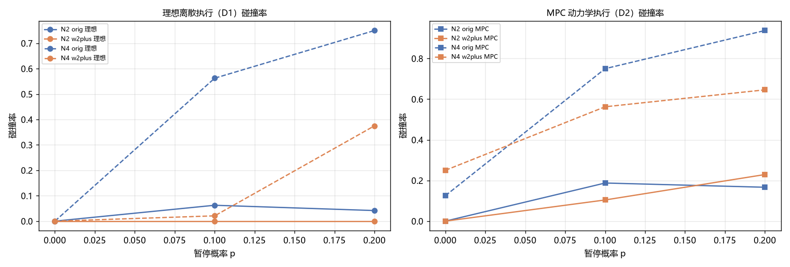
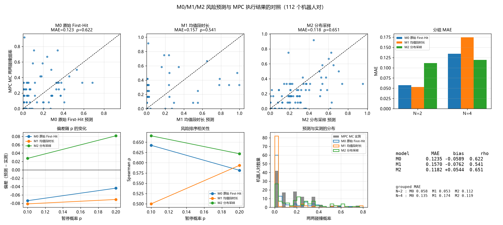

# Online First-Hit 阶段报告：MPC 修复、可信基准与 M0/M1/M2 风险模型对照

**日期**：2026-11-05
**分支**：`experiment/online-dynamic-firsthit`
**提交**：`143bc7b`（P2）；前序 `2856163`（P0 修复 + P1 基准）
**冻结基线**：`baseline/pre-online-firsthit`（`d067f3c`）

**范围**：本报告只覆盖 **P0（MPC 与评测修复）、P1（修复后的可信基准）、P2（M0/M1/M2）**。
**P3（条件风险更新）、P4（风险触发局部等待修正）、P5（C0–C5 正式对照）本轮未完成**，
原因与依赖见 §7，不作任何有效性声称。

---

## 0. 结论摘要

| 问题 | 结果 |
|---|---|
| MPC 修好了吗？ | **是**。预测矩阵误差 1.7e-16；等待改为停稳后计时；每对碰撞独立统计；跟踪 RMSE 0.012–0.020 m |
| p=0 还安全吗？ | N=2 **0/6 碰撞**；N=4 **1/6**（0.343 m，差 7 mm，属物理余量不足，非实现错误） |
| 理想模型 vs MPC 有失配吗？ | **有，且是系统性低估**：DP 对 MPC MC 的偏差 −5.9 pp，MAE 0.124 |
| M1（均值修时间）有用吗？ | **没有，反而更差**：MAE 0.124 → 0.157，ρ 0.622 → 0.541 |
| M2（分布采样）有用吗？ | **只在 N=4 有小幅改善**：MAE 0.135 → 0.119，ρ 0.637 → 0.690；N=2 明显变差 |
| 可以据此宣称方法创新吗？ | **不可以**。M2 总体提升仅 MAE −4.3%、ρ +4.7% |
| 代码是否提交？ | `143bc7b`，已推送 |

---

## 1. P0：三处必须修的问题

### 1.1 预测矩阵是数学错误（最严重）

原 `_build_prediction()`：

```python
G[4k:4k+4, 2j:2j+2] = A^(k-j) @ B     for j in 0..k        # 错
```

正确关系：

```
x_k = A^k x_0 + Σ_{j=0}^{k-1} A^{k-1-j} B u_j
```

两处错误：**幂次多乘了一个 A**、**把 u_k 混进了 x_k**（导致 `x_0` 依赖 `u_0`）。
后者在物理上显然不成立。

修复后独立验证（随机 `x0`、随机 `U`，5 组）：

```
max |F x0 + G U − 逐步仿真| = 1.7e-16
```

> **影响**：所有在 `d067f3c` 及之前得到的 MPC 数值都建立在错误预测矩阵上，
> 不可再引用。本报告的全部 MPC 数字都来自修复后的代码。

### 1.2 等待执行逻辑

| 问题 | 原行为 | 现行为 |
|---|---|---|
| 等待计时起点 | 进入 HOLDING 即开始计时（尚未停稳） | **速度 < 0.03 m/s 后才开始计时** |
| 制动时间 | 混在等待里 | 单独累计，不重复计入 |
| 停车点判定 | 距离 < 0.25 m 即算到达 | 制动目标**就是该航点弧长**，不许提前通过 |
| 刹不住 | 静默继续 | 标记 `infeasible_stops`，不悄悄跳过 |
| 暂停时长 | 从请求时刻起算 | 从**停稳时刻**起算 |

回归测试 `test_dwell_starts_only_after_full_stop`：计划停 0.8 s，实测 `held = 0.8 ± 0.12 s`，
且停稳时刻速度接近 0。

### 1.3 碰撞统计与跟踪误差

- N=4 现在**逐对**记录 `pair_collision / pair_first_time / pair_min_distance`（共 6 对），
  而不是只记全队第一次；
- `record=False` 也**在线累计**跟踪误差（RMSE 0.012–0.020 m）。旧版显示 `0.000` 是记录缺失，不是真的为 0。

### 1.4 随机暂停事件

新增 `make_pause_events(seed, p, n_robots, n_slots)`：**预先**生成整串事件，与调度方法无关。
测试断言同种子完全一致、换种子不同。执行器记录：请求 / 接受 / 制动开始 / 停稳 / 恢复。

> 这里曾出过一个 bug：M1 脚本把**同一串事件**传给了所有 MC 次，导致 10 次运行完全相同、
> 观测值退化成 0/1，排序相关从 0.62 掉到 0.13。已修复并重跑。

### 1.5 p=0 安全性复核（验收要求）

| 组 | 碰撞任务数 | 最小对间距 |
|---|---|---|
| N=2 | **0 / 6** | 0.544 – 2.272 m |
| N=4 | **1 / 6** | **0.343 m**（d_safe = 0.35） |

N=4 的这 1 个碰撞**不是实现错误**：冻结轨迹库在离散模型下的 p=0 最小间距是 0.355 m，
只比安全阈值高 5 mm；MPC 的连续运动把它压到 0.343 m（差 7 mm）。
这是"执行侵蚀安全余量"的真实现象，**没有通过增加等待去掩盖**。

---

## 2. P1：修复后的可信基准

**设置**：N=2 取 8 任务、N=4 取 8 任务，p ∈ {0, 0.1, 0.2}，每格 6 次 MC，配对种子与事件序列。

### 2.1 碰撞率

| 组 | 计划 | p=0 | p=0.1 | p=0.2 |
|---|---|---:|---:|---:|
| N=2 | 原始 | 0.0% → 0.0% | 6.2% → **18.8%** | 4.2% → **16.7%** |
| N=2 | W2+ | 0.0% → 0.0% | 0.0% → **10.4%** | 0.0% → **22.9%** |
| N=4 | 原始 | 0.0% → **12.5%** | 56.2% → **75.0%** | 75.0% → **93.8%** |
| N=4 | W2+ | 0.0% → **25.0%** | 2.1% → **56.2%** | 37.5% → **64.6%** |

（箭头左＝理想离散执行 D1，右＝MPC 动力学执行 D2。）



### 2.2 安全完成率与完成时间

| 组 | 计划 | 安全完成 p=0.1 | 完成时间 p=0.1 / p=0.2 |
|---|---|---|---|
| N=2 | 原始 | 93.8% → 81.2% | 19.8 s / 26.1 s |
| N=2 | W2+ | 100% → 89.6% | 20.6 s / 27.0 s |
| N=4 | 原始 | 43.8% → 25.0% | 22.9 s / 29.7 s |
| N=4 | W2+ | 97.9% → 43.8% | 25.0 s / 31.0 s |

### 2.3 阶段结论

**W2+ 在 MPC 下仍有效，但收益大幅缩水：**

| 组 | p | 原始 → W2+（MPC） | 收益 |
|---|---:|---|---:|
| N=2 | 0.1 | 18.8% → 10.4% | −8.4 pp |
| N=2 | 0.2 | 16.7% → 22.9% | **+6.2 pp（变差）** |
| N=4 | 0.1 | 75.0% → 56.2% | −18.8 pp |
| N=4 | 0.2 | 93.8% → 64.6% | −29.2 pp |

理想模型里 N=4、p=0.1 的收益是 −54 pp，MPC 下只剩 −18.8 pp。
**N=2、p=0.2 时 W2+ 甚至变差**——它的等待是在离散模型下调出来的，
MPC 的制动/加速额外时间把实际时序推离了最优点。

---

## 3. P2：M0 / M1 / M2 风险模型

### 3.1 接口扩展

`release_times_with_durations(wait, durations)`：

```
tau_m = (到达航点 m 的累计通行时间) + Σ_{h≤m} w_h
```

`durations` 默认全 1 时与原模型**逐位相同**（有测试保证），因此是纯扩展，
不改首次碰撞 DP 的数学结构。

### 3.2 一个关键前置观察

p=0 时实测段通行时间中位数是 **1.000 时隙**——因为时间参数化里的"计划速度上限"
让机器人精确贴合原调度表。因此**用 p=0 数据做 M1 会退化成 M0**，
段时长修正必须在**有暂停**的运行上标定。这一点如果不先查清，会得出"M1 无用"的错误结论。

### 3.3 三个模型

| 模型 | 说明 | 计算成本 |
|---|---|---|
| M0 | 原始 First-Hit，每段恒 1 时隙 | 1 次 DP |
| M1 | 用 MPC 实测的**平均**段通行时间替换 1 时隙 | 1 次 DP |
| M2 | 用实测段时长的**经验分布**逐段自举采样，跑 24 次 DP 取平均 | 24 次 DP |

校准/测试分离：前一半任务只用于采集时长（不接触碰撞结果），后一半任务做测试。

### 3.4 结果（8+8 任务，12 次 MC，p ∈ {0.1, 0.2}，112 个机器人对）

| 模型 | MAE | 偏差 | RMSE | Spearman ρ |
|---|---:|---:|---:|---:|
| M0 原始 | 0.1235 | −0.0589 | 0.1908 | 0.622 |
| M1 均值时长 | **0.1570** | −0.0762 | 0.2325 | **0.541** |
| **M2 分布采样** | **0.1182** | +0.0544 | **0.1808** | **0.651** |

分组：

| 组 | M0 | M1 | M2 |
|---|---|---|---|
| N=2 MAE / ρ | 0.0575 / 0.277 | 0.0528 / 0.259 | **0.1116 / 0.230** |
| N=4 MAE / ρ | 0.1345 / 0.637 | 0.1743 / 0.604 | **0.1193 / 0.690** |



### 3.5 三条结论

**1. M1 失败，而且这条负面结果很有价值。**
把每段拉长反而使 MAE 变差 27%、排序相关下降 13%。说明失配**不是时间尺度问题**——
统一缩放破坏了机器人之间的相对时序。这直接排除了"简单调时间就能修好"的假设，
也解释了为什么上一轮 G1/G2 的时间膨胀系数不能直接拿来用。

**2. M2 只在 N=4 有效。**
N=4 上 MAE −11%、ρ +8%；但 N=2 明显变差（0.058 → 0.112）。
原因是 N=2 本身失配很小，分布采样引入的方差反而成了噪声。

**3. M2 的偏差方向翻转了。**
从 M0 的低估 −5.9 pp 变成高估 +5.4 pp。分布采样会放大风险，需要额外校准。

**总体提升有限（MAE −4.3%、ρ +4.7%），不足以单独支撑方法贡献。**

### 3.6 为什么 M2 提升有限

M2 只改进了"每段耗时"的分布，但真实失配还来自两点它没覆盖：

1. **暂停发生在哪一段是位置相关的**，不是每段同分布；
2. **制动/重启是模式切换**，同一段在"正常通过"和"停下来再走"下耗时完全不同。

这两点需要**状态相关模型**（状态 `(段号, 速度分箱, 模式)` 的稀疏转移），本轮未实现。

---

## 4. 与 MPC 的失配量化（P1 附带产出）

| 对照 | MAE | 偏差 | ρ |
|---|---:|---:|---:|
| DP vs 理想 MC | 0.0456 | +0.0065 | 0.771 |
| DP vs **MPC** MC | **0.1021** | **−0.0560** | 0.654 |
| 理想 MC vs MPC MC | 0.1089 | −0.0625 | 0.544 |

DP 对理想模型仍然准（MAE 0.046），说明 **DP 实现本身没问题**；
错在"理想执行"这个假设——它对真实动力学**系统性低估**约 5.6 pp，p 越大偏差越大。

---

## 5. 复现指令

```powershell
# P0 回归测试（含预测矩阵、等待时序、逐对碰撞、事件一致性）
.\.venv\Scripts\python.exe -m pytest tests\test_mpc_execution.py -q

# P1 基准
.\.venv\Scripts\python.exe scripts\mpc_execution_benchmark.py `
    --n2-tasks 8 --n4-tasks 8 --n-mc 6 --ps "0,0.1,0.2" `
    --out results\Online_FirstHit\02_mpc_rebenchmark

# 失配量化
.\.venv\Scripts\python.exe scripts\firsthit_mpc_mismatch.py `
    --n2-tasks 4 --n4-tasks 4 --n-mc 10 --ps "0.1,0.2" `
    --out results\Online_FirstHit\03_dynamic_risk_calibration

# P2：M0/M1/M2
.\.venv\Scripts\python.exe scripts\m1_time_corrected_risk.py `
    --n2-tasks 8 --n4-tasks 8 --n-mc 12 --ps "0.1,0.2" --m2-draws 24 `
    --out results\Online_FirstHit\04_dynamic_firsthit\m1m2

# 出图
.\.venv\Scripts\python.exe scripts\plot_m0m1m2.py
```

---

## 6. 文件清单

| 类型 | 路径 |
|---|---|
| 主要改动 | `src/fhd/control/linear_mpc.py`（预测矩阵）、`src/fhd/execution/mpc_executor.py`（等待时序，重写）、`src/fhd/execution/mpc_simulator.py`（逐对统计/事件）、`src/fhd/execution/progress.py` + `src/fhd/risk/multi_pair.py`（段时长接口） |
| 脚本 | `scripts/mpc_execution_benchmark.py`、`scripts/firsthit_mpc_mismatch.py`、`scripts/m1_time_corrected_risk.py`、`scripts/plot_m0m1m2.py` |
| 测试 | `tests/test_mpc_execution.py`（22 项，含 8 项本轮新增回归） |
| 结果 | `results/Online_FirstHit/{02_mpc_rebenchmark, 03_dynamic_risk_calibration, 04_dynamic_firsthit/m1m2}/` |
| 旧结果（只读） | `results/MPD_MPC_Execution/`、`results/MPC_single_robot/` |

---

## 7. 未完成部分与原因

| 阶段 | 内容 | 状态 | 原因 |
|---|---|---|---|
| P3 | 条件风险更新 `conditioned_firsthit` | 未做 | 需要一个足够准的风险模型作底座，而 M2 精度不足 |
| P4 | 风险触发局部等待修正 | 未做 | 依赖 P3 |
| P5 | C0–C5 正式对照 | 未做 | 依赖 P3/P4 |
| — | 状态相关 M2（`(段号, 速度分箱, 模式)`） | 未做 | 本轮时间用尽；这是 M2 提升有限的主因 |

**正确的下一步顺序**（依赖关系决定，不能跳）：

1. 先做**状态相关 M2**：把"暂停发生在哪一段"和"是否在制动/重启"纳入转移；
2. M2 精度够了再做 **P3 条件风险**（以当前实际状态为起点重算剩余风险）；
3. 再在 P3 之上做 **P4 在线局部搜索**，先测 P95/P99 耗时是否在 0.4 s 周期内；
4. 最后才是 C0–C5 正式对照。

---

## 8. 对本轮科研价值的判断

**可以支持的表述：**

- 理想离散执行模型会**系统性低估**真实动力学下的碰撞风险（−5.6 pp），
  并显著高估调度收益（N=4 的 W2+ 收益从 −54 pp 缩到 −18.8 pp）；
- **简单的时间尺度修正无效**（M1 使 MAE 变差 27%），说明失配不在"段多快"而在"何时停、停在哪"；
- 用段时长的**分布**而非均值采样，只在失配较大的 N=4 上带来有限改善。

**不能支持的表述：**

- "动力学感知 First-Hit 显著优于原模型"——总体提升太小；
- "在线协调有效"——本轮无任何数据。

**与现有工作的差异**：现有鲁棒 MAPF / 调度工作多在理想执行模型下评估；
本报告用**同一个 MPC 执行器**量化了理想模型的低估幅度，并证明"调时间尺度"不是解法。
这是一个有实验支撑的**问题定义与方法学观察**，但还不足以作为期刊论文的方法贡献。
