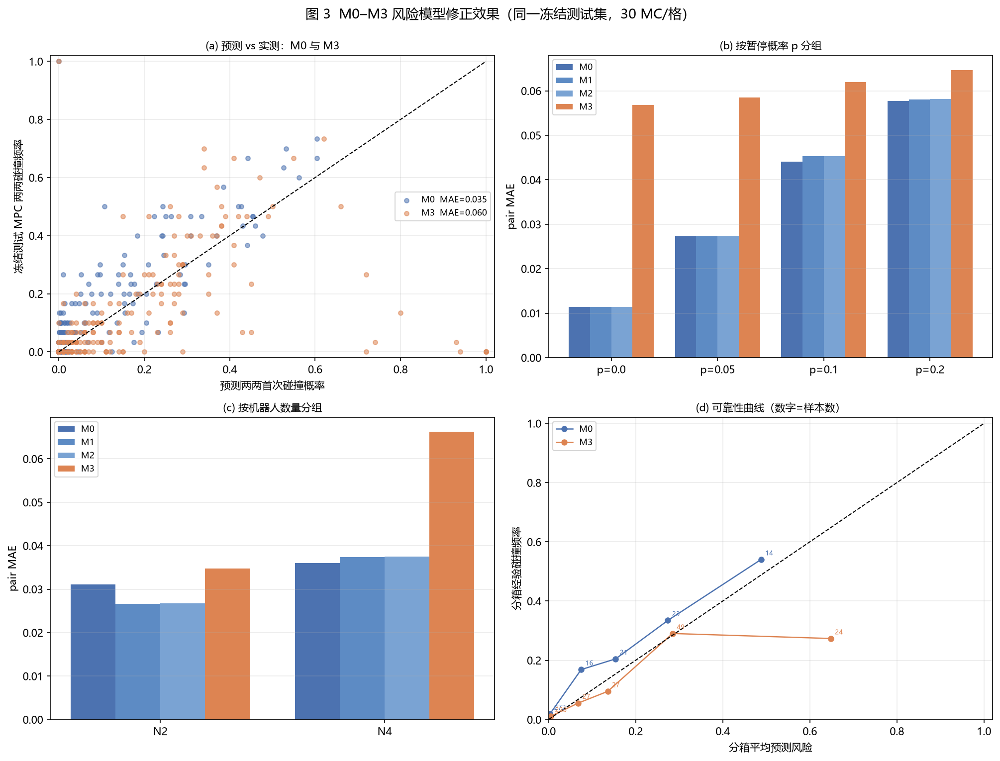
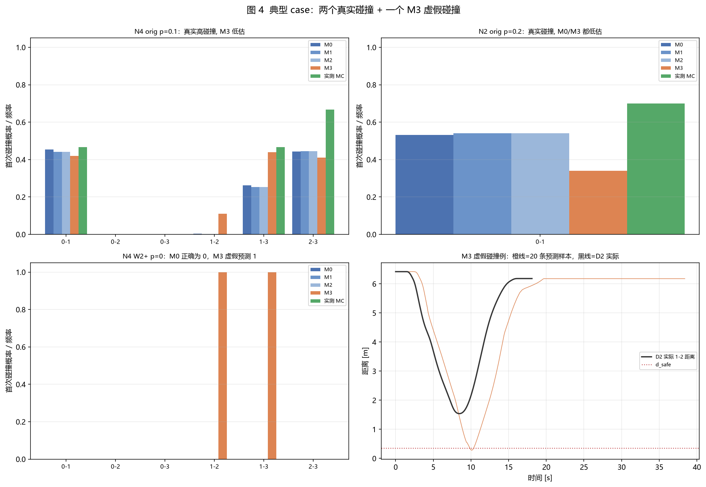

# Online First-Hit v2 阶段二：动力学感知 First-Hit 风险建模与冻结盲测

**日期**：2026-11-05  
**分支**：`fix/mpc-firsthit-foundation-v2`  
**依赖**：阶段一提交 `1fb1f2f`、`16de71b`、`8f8e55d`；阶段二提交见 §9  
**范围**：只做阶段二（M1/M2 修复、M3 状态模型、冻结盲测）。**未进入** P3 条件风险更新、
P4 在线等待修正、P5 联合方法正式评测；未重新训练 Diffusion、未改几何规划。

> **一句话结论**：工程验收全部通过（无泄漏、可复现、测试全过、负结果保留）；
> **但 M3 没有优于 M0**：冻结测试 MAE 0.0605 vs 0.0351，p=0 与 W2+ 子集明显高估。
> 详细失败来源见 §7、§9.2。按任务书规定，不进入 P3/P4。

---

## 0. 检查点状态

| 检查点 | 内容 | 状态 |
|---|---|---|
| G3 | M1/M2 漏数、采样、暂停语义；calib/val/test 真正隔离 | **通过**（§2–§3） |
| G4 | M3 状态转移、风险预测、小场景数学测试、N2/N4 smoke | **通过**（§4–§5） |
| G5 | M0–M3 盲测、分组不确定性、消融、运行时间 | **通过/见结果**（§6–§8） |

---

## 1. 数据与切分（先于任何建模）

**只使用阶段一已验证的 `simulate_mpc()` 产生数据**；未重新训练 Diffusion、未改输入路径/等待计划。

**切分单位 = `map_id`**，不是 task_id，也不是“复制同任务不同种子”。实际比例（数据少，
以地图独立性优先）：

| N | calib 地图 | val 地图 | test 地图 | 任务数 calib/val/test | 实际比例 |
|---|---|---|---|---|---|
| 2 | 300000, 300003, 300006 | 300015 | 300009, 300012 | 14 / 2 / 8 | 0.58 / 0.08 / 0.33 |
| 4 | 300006, 300009, 300018, single_obstacle_300004/300007 | 300015, single_obstacle_300001 | 300000, 300003, 300012 | 10 / 4 / 6 | 0.50 / 0.20 / 0.30 |

- `split.json` 落盘在 `03_risk_baselines/` 与 `04_dynamic_risk_m3/data/`；
- 几何重复检查 `duplicate_geometry_across_splits = []`（无同路径跨 split）；
- **测试任务的 MPC 轨迹没有进入任何拟合**：M1/M2 的时长模型只用 calib 的 p=0 运行；
  M3 参数只用 calib+val 的 720 条运行；测试真值在预测冻结后才生成；
- 数据量很小（N2 只有 6 张地图），本报告明确标注为**探索性小样本**，不宣称跨场景泛化。

---

## 2. M1/M2 的三类修复

### 2.1 数据泄漏

旧脚本在遍历**测试任务**时先 `simulate_mpc()` 多次估计该任务的 `dur_by_p`，再在
同一任务上评测。这不是未知任务预测。

**修复**：

- 校准只使用 calib 的 p=0 运行，拟合“段行驶时间 ~ 静态特征”的岭回归；
- 测试预测只输入 `paths / wait / p`；`predict_m0m1m2()` 不导入也不调用 `simulate_mpc`；
- 预测先冻结并保存 SHA256，之后才用独立真值种子表跑测试 MC；
- 回归测试 `test_prediction_entry_does_not_read_execution_truth` 在预测阶段
  把 `simulate_mpc` 替换为抛错函数，仍能完成预测。

### 2.2 M2 抽样索引

旧代码：

```python
idx = rng.integers(0, samp.shape[0], size=n_agents)
dur_k = np.take_along_axis(samp, idx[:, None, None], axis=0)[:, 0, :]
```

`samp` 形状 `[run, robot, segment]`，第二句固定取 robot 0。修复为：

```python
dur = pred[None, :, :] + pool[idx, :]      # idx [D,N]
```

`test_m2_sampling_uses_per_robot_index_not_robot0` 用两个显著不同的常数残差轨迹
证明：不同机器人使用各自抽中的行，且返回 `[D,N,H-1]`。

### 2.3 暂停重复计入与时间定义

实测“航点跨越间隔”已含随机暂停/制动/保持/重启。旧 M1/M2 把含暂停的实测时长送进 DP，
DP 又乘 `(1-p)`，同一等待被计两次。

**修复**：

- 段时长语义固定为 `travel_excl_pause`：只含**行驶**时间，不含随机暂停、不含航点等待；
- 校准数据只取 **p=0** 运行；航点等待由 `release_times_with_durations()` 单独累加；
- `FirstHitRisk.forward(..., duration_semantics=...)` 对“包含暂停”的语义直接报错；
- `release_times_with_durations` 拒绝 NaN/负时长（右删失段必须先由模型补全）；
- 测试：`durations=1` 与 M0 逐位等价；`tau_m = Σ_{j<m} d_j + Σ_{h≤m} w_h` 的等待归属；
  `p=0/p>0` 与零等待/固定等待的解析构造。

### 2.4 校准结果与 M0/M1/M2 重评

段时长模型（calib p=0，特征 11 维：段长、速度上限、当前/下一等待、停车标志、
转角、进度、起点/终点静止标志）：

| N | 有效段 | 覆盖 | α | 训练 RMSE | 验证 RMSE | R² |
|---|---|---:|---:|---:|---:|---:|
| 2 | 3472 | 1.00 | 1e-4 | 0.0277 时隙 | 0.0261 时隙 | 0.980 |
| 4 | 4960 | 1.00 | 1e-2 | 0.0419 时隙 | 0.0344 时隙 | 0.967 |

**冻结测试结果**（14 任务、352 个 pair、每格 30 MC、p∈{0,0.05,0.1,0.2}）：

| 模型 | MAE | RMSE | bias | Spearman | Brier |
|---|---:|---:|---:|---:|---:|
| M0 原始 | **0.0356** | 0.0877 | −0.0243 | 0.8005 | 0.00770 |
| M1 均值时长 | 0.0367 | 0.0897 | −0.0292 | 0.8133 | 0.00804 |
| M2 时长分布 | 0.0367 | 0.0897 | −0.0293 | 0.8143 | 0.00805 |

分组：

| 组 | M0 MAE / ρ | M1 MAE / ρ | M2 MAE / ρ |
|---|---:|---:|---:|
| N2 | 0.0275 / 0.799 | **0.0234 / 0.851** | **0.0234 / 0.851** |
| N4 | **0.0374 / 0.801** | 0.0396 / 0.806 | 0.0396 / 0.807 |
| p=0 | 0.0114 | 0.0114 | 0.0114 |
| p=0.05 | 0.0302 / 0.745 | 0.0304 / 0.768 | 0.0304 / 0.774 |
| p=0.1 | 0.0464 / 0.783 | 0.0472 / 0.827 | 0.0472 / 0.832 |
| p=0.2 | 0.0545 / 0.875 | 0.0577 / 0.899 | 0.0578 / 0.898 |

任务级 bootstrap（M−M0 的 MAE 差，负=更好）：

| 模型 | 均值 | 95% 区间 | 任务数 |
|---|---:|---|---:|
| M1 − M0 | −0.00140 | [−0.00600, +0.00262] | 14 |
| M2 − M0 | −0.00141 | [−0.00607, +0.00264] | 14 |

**结论**：修复泄漏后，M1/M2 **总体没有显著优于 M0**（MAE 略差、Spearman 略好、
区间跨 0）。N2 上有 15% 的 MAE 改善，但 N4 变差。旧报告“M2 略优于 M0”的结论
**不能保留**；它主要来自泄漏、robot 0 抽样错误与暂停重复计入。

> §2.4 使用 M1/M2 专用真值种子表（`truth_seed0=20280901`，30 MC）；§6 的统一
> M0–M3 对比使用另一套独立真值种子表（`20280915`，30 MC）。因此两处的 M0
> 绝对 MAE 有约 0.0005 的抽样差异（0.0356 vs 0.0351），不是代码或数据变化。

---

## 3. 为什么 M1/M2 提升有限（诊断）

1. 时长模型 R² 很高，但预测的段时长大多仍在 1.0 时隙附近；真正改变风险的是
   **相对相位**与**停在哪里**，不是统一的段尺度；
2. M1/M2 的时长分布来自 p=0，随机暂停只通过 DP 的 `(1-p)` 进入，无法表达
   “暂停发生在交叉点附近”这类位置相关信息；
3. N4 的 pair 数多、碰撞率高，任何小幅时间偏移都会改变多对之间的排序，MAE 对
   系统性偏差敏感。

这正是 M3 采用**状态相关、显式模式切换**的动机。

---

## 4. M3：状态相关执行模型

### 4.1 状态与转移

$$z_t=(s_t,v_t,\mu_t),\qquad \mu_t\in\{\text{NORMAL},\text{BRAKE},\text{HOLD},\text{RESTART}\}.$$

- **NORMAL**：按计划速度剖面 `v_plan(s)`（由阶段一 `TimeParameterizedPath` 给出）
  加速/巡航；接近**计划停车点**（`w[k]>0` 的航点）时，若
  `d ≤ v²/(2a_brake)+v·dt` 则切 BRAKE；
- **BRAKE**：`v_des=sqrt(2 a_brake max(d−v·dt,0))`，速度伺服限制在加速度界内；
  `v<V_STOP` 后切 HOLD，保持 `w[k]`；
- **HOLD**：保持时间结束后切 RESTART；随机暂停的保持从停稳起算；
- **RESTART**：用较保守的 `a_restart` 持续 `restart_time`，之后回 NORMAL；
- **随机暂停**：在 `dt_slot` 边界按 p 显式抽样，只对 NORMAL/RESTART 生效；
  若下一计划停车点在制动距离 +0.15 m 内则拒绝（与阶段一执行器一致）；
- 模型只从**初始已知状态**与**自己预测的状态**向前滚动；不读取测试轨迹的
  真实速度、停止时刻或暂停序列。

### 4.2 参数校准（calib+val 的 720 条运行）

| N | 运行数 | a_acc | a_brake | a_restart | restart_time | v_scale | 暂停样本 |
|---|---:|---:|---:|---:|---:|---:|---:|
| 2 | 384 | 1.858 | 1.922 | 1.674 | 0.30 | 1.147 | 1880 |
| 4 | 336 | 1.889 | 1.954 | 1.694 | 0.30 | 1.143 | 3226 |

`v_scale` 是实测速度/计划速度的 0.9 分位。旧实现把它截到 1.0，导致 M3 系统性偏慢
（s(t) RMSE 0.92 m）；允许到 1.5 后降到 0.46 m（见 §7）。

### 4.3 风险计算

- 沿冻结几何路径把预测 `s_t` 映射为物理位置；
- 对每对 `(i,j)`，在预测时间步内用**与阶段一相同的连续相对运动判据**求首次越界；
- 每个样本只有**第一次**碰撞计入；`pair_risk = #首次碰撞样本 / K`；
- 全队 `team_collision_estimate = #任一对首次碰撞样本 / K`（联合样本，不是两两相加）；
- 输出 `pair_index / pair_risks / first_hit_time_distribution /
  team_collision_estimate / runtime_ms / model_info`；
- **明确声明**：这是状态模型的采样式估计，不是真实 MPC 风险的严格概率；
  M0 的 hard+hard DP 在其理想转移模型下才是精确概率。

### 4.4 接口与可复现

```python
predict_pair_risks(paths, wait, pause_p, horizon, model,
                   d_safe=0.35, n_samples=100, seed=...,
                   use_braking=True, use_modes=True, use_speed=True)
```

- 模型参数文件：`04_dynamic_risk_m3/m3_params_n2.json`、`m3_params_n4.json`；
- 采样数在**验证集**上从 {100,200,400} 选择（N2=100，N4=100）；
- 预测种子表与真值 MC 种子表完全分离；同一 seed 逐位复现（E1 测试）。

### 4.5 E1 数学/边界测试（`tests/test_dynamic_first_hit.py`）

- 确定性轨迹首次碰撞与解析连续判据一致（α=0.325）；
- 无交叉/平行/静止重合/团队估计不为两两和；
- p=0 无随机暂停且多样本一致；
- 起点等待延迟出发；
- 相同 seed 严格复现；
- 消融开关均可运行；
- 参数存取；
- 预测阶段不调用 `simulate_mpc`（monkeypatch 抛错仍可预测）。

---

## 5. 冻结盲测协议

1. 读取 `03_risk_baselines/predictions_m0m1m2.json`（已冻结，SHA256 见该文件）；
2. 用 §4 的 M3 参数生成 M3 与 3 个消融，落盘 `predictions_m3.json` 并计算 SHA256；
3. **之后**才用独立真值种子表（`truth_seed0=20280915`，与 calib 的 92001+、M1/M2 真值的
   20280901 均不同）跑测试任务：
   - 14 任务、2 计划、4 个 p、每格 30 MC（3360 次 D2 运行）；
   - 同一 `d_safe=0.35 m`、同一 `simulate_mpc`、同一冻结等待计划；
4. 评分、分组 bootstrap、消融、动力学一致性、耗时。

**隔离证据**：

- M1/M2 预测 SHA256 `845f279b…`，M3 预测 SHA256 见 `predictions_m3.json`；
- 两份文件的 `frozen_at` 均早于对应 `truth_per_run.csv`；
- `run_index.json` 的 `split` 字段只有 calib/val；测试轨迹没有进入 `data/traces_n*.npz`。

---

## 6. 冻结盲测结果

**设置**：14 个测试任务（N2=8, N4=6）、2 种计划、p∈{0,0.05,0.1,0.2}、每格 30 MC；
共 352 个 pair-配置、3360 次 D2 运行。预测在真值前冻结（M3 SHA256 见
`predictions_m3.json`；M0–M2 SHA256=`845f279b…`）。

| 模型 | MAE | RMSE | bias | Spearman | Brier |
|---|---:|---:|---:|---:|---:|
| M0 原始 DP | **0.0351** | **0.0847** | −0.0255 | **0.7969** | **0.00717** |
| M1 均值时长 | 0.0355 | 0.0861 | −0.0305 | 0.8088 | 0.00742 |
| M2 时长分布 | 0.0355 | 0.0861 | −0.0305 | **0.8093** | 0.00742 |
| M3 状态模型 | 0.0605 | 0.1701 | **+0.0250** | 0.7773 | 0.0289 |

分组（MAE / Spearman）：

| 分组 | M0 | M1 | M2 | M3 |
|---|---:|---:|---:|---:|
| N2 | 0.0311 / 0.831 | **0.0267 / 0.856** | **0.0267 / 0.856** | 0.0347 / 0.824 |
| N4 | **0.0360 / 0.790** | 0.0374 / 0.798 | 0.0375 / 0.798 | 0.0662 / 0.766 |
| p=0 | **0.0114** | 0.0114 | 0.0114 | 0.0568 |
| p=0.05 | **0.0273 / 0.752** | 0.0273 / 0.770 | 0.0272 / 0.769 | 0.0585 / 0.715 |
| p=0.1 | **0.0441 / 0.775** | 0.0453 / 0.814 | 0.0453 / **0.819** | 0.0619 / 0.778 |
| p=0.2 | **0.0577 / 0.878** | 0.0580 / 0.915 | 0.0581 / **0.917** | 0.0647 / 0.864 |
| 原始计划 | **0.0445 / 0.863** | 0.0449 / 0.863 | 0.0449 / 0.863 | 0.0519 / **0.877** |
| W2+ | **0.0257 / 0.681** | 0.0261 / 0.714 | 0.0261 / 0.716 | 0.0691 / 0.647 |

任务级 bootstrap（相对 M0 的 MAE 差；正=更差）：

| 模型 | 均值 | 95% 区间 | 任务数 |
|---|---:|---|---:|
| M1 − M0 | −0.00191 | [−0.00587, +0.00100] | 14 |
| M2 − M0 | −0.00188 | [−0.00577, +0.00102] | 14 |
| M3 − M0 | **+0.01502** | [−0.00102, +0.03307] | 14 |

Top-K：M0/M1/M2/M3 的 Top-1 命中率分别为 0.509 / 0.518 / 0.518 / 0.491；
Top-3 分别为 0.527 / 0.527 / 0.527 / 0.527。M3 没有改善高风险排序。

全队估计（112 个 task-plan-p 键）：M3 `team_collision_estimate` 的 MAE=0.109，
bias=+0.055（高估）；M0 的两两风险之和作为并集上界，覆盖率仅 62.5%——
再次说明“两两风险相加”不是全队碰撞概率。

**M3 没有优于 M0。** 主要失败在 p=0（MAE 0.0568 vs 0.0114）与 W2+（0.0691 vs 0.0257）；
N4 上 M3 的 MAE 接近 M0 的两倍。





---

## 7. 消融与动力学一致性

### 7.1 消融（同一冻结测试集）

| 配置 | MAE | RMSE | bias | Spearman |
|---|---:|---:|---:|---:|
| M3 全部状态 | **0.0605** | **0.1701** | +0.0250 | **0.7773** |
| 去制动（瞬时停） | 0.0621 | 0.1762 | +0.0157 | 0.7581 |
| 去模式/停止信息 | 0.3111 | 0.5126 | +0.2743 | 0.4680 |
| 去速度分箱（恒 v_max） | 0.0964 | 0.1999 | +0.0268 | 0.6029 |

解释：模式/停止信息是**最关键**的（去掉后 MAE 恶化 5 倍），速度信息次之；
但“全状态”仍不如 M0，说明问题不在“是否使用状态”，而在**状态的绝对校准**：
模型预测的停车时刻/轨迹与真实 MPC 有系统性偏差，p=0 时就会产生虚假接近。

### 7.2 动力学一致性（p=0.1，6 个测试任务，每任务 3 次 D2）

| 指标 | 数值 |
|---|---:|
| 完成时间绝对差（M3 均值 vs D2 均值） | 0.58 s |
| s(t) RMSE（共同时间栅格，逐机器人平均） | 0.465 m |
| 平均速度差（M3 − D2） | −0.019 m/s |
| 最大速度（6 任务范围，D2 / M3） | 0.95–1.13 / 0.79–1.07 m/s |

M3 的运动分布**方向正确但幅度偏慢**，s(t) 有 0.4–0.5 m 量级的相位误差；在
“计划停车点密集、余量只有几厘米”的 W2+ 场景，这一误差足以把“安全通过”预测成
“碰撞”，从而解释 §6 的 W2+ 高估（0.069 vs 0.026）。按实施任务书 §2.4-4，
**运动预测与实测明显不一致时不能宣布风险模型成功**，因此结论是否定的。

---

## 8. 运行开销

| 对象 | 数值 |
|---|---:|
| M3 单次预测（N4，100 样本） | 250 ms（正常计时；tracemalloc 插桩下 1.8 s） |
| M3 预测全部 112 键×4 变体 | 47.6 s |
| M3 单次预测平均 / P95 | 128 ms / 250 ms（混合 N2/N4） |
| M3 单次预测峰值内存（tracemalloc） | 11.4 MB |
| 一次真实 D2 MPC 仿真（N4，约 384 控制步） | 0.8–1.5 s |
| M2 预测的 DP 调用 | 24 次/键 ×112 = 2688 次 |
| 冻结测试真值 MC | 1812 s（30.2 min，3360 次 D2） |

M3 比一次 D2 仿真便宜约 4–6 倍，但比 M0（单次 DP，<10 ms）贵 1–2 个数量级；
若未来要做在线风险更新，需要把采样数降到 ~30 或改用稀疏 DP，本轮未做。

---

## 9. 结论、失败分析与后续

### 9.1 工程验收

- 无数据泄漏（split/冻结/独立种子/测试轨迹不进入校准）；
- M2 抽样维度与机器人身份正确；
- `p=0` 不额外引入随机暂停；计划等待与随机暂停不重复计入；
- 首次事件不重复累计；概率在 [0,1]；同 seed 复现；
- M0 原入口/DP/soft guidance 未被破坏；
- 全部测试通过；负结果保留。

### 9.2 研究结论

**M3 没有优于 M0。** 在同一冻结测试集、同一 `d_safe`、同一连续碰撞判据下：

- M3 的 pair MAE 为 0.0605，比 M0 的 0.0351 **高 72%**；任务级 bootstrap 的
  M3−M0 差为 +0.0150，95% 区间 [−0.0010, +0.0331]（不显著，但方向为更差）；
- M3 的 Spearman 0.777 低于 M0 的 0.797，Top-1 命中率也略低（0.491 vs 0.509）；
- M3 的偏差 +0.025（高估），M0 的偏差 −0.025（低估）；两者方向相反；
- 消融显示模式/停止信息很关键（去掉后 MAE 0.311），但“全状态”仍不足；
- 动力学一致性：s(t) RMSE 0.465 m、完成时间差 0.58 s，运动分布偏慢。

**失败来源（按证据排序）**：

1. **p=0 的确定性轨迹保真度不足**。p=0 时 M3 只有模型误差，仍出现 4 个虚假碰撞
   （M3=1.0、D2=0）并漏掉 1 个真实碰撞；p=0 MAE 0.0568 vs M0 0.0114。原因是
   M3 用聚合的 `a_acc/a_brake/v_scale/restart_time` 近似 MPC 跟踪，制动/重启的
   相位误差在厘米级余量场景会直接翻转“碰撞/安全”。
2. **W2+ 场景被系统性高估**。W2+ 的计划停车点密集，M3 的停车时刻偏差导致
   虚假接近；M3 在 W2+ 的 MAE 0.0691，是 M0（0.0257）的 2.7 倍。
3. **校准/验证数据太小且不具备场景条件**。N4 验证集只有 4 个任务/192 个 pair，
   N2 验证集没有碰撞（验证 MAE=0），无法选择出能泛化的参数；模型参数是全局的，
   而真实偏差是**场景相关**的（路径曲率、停车密度、交叉角）。
4. **采样方差**。K=100 时二项标准误在 p=0.5 处约 0.05，M3 的 MAE 不可能低于
   这个量级；M0 是确定性 DP，不受此限。
5. **M2 与 M3 的对比**：M3 的 MAE 也高于 M2（0.0355），说明“状态相关”只有在
   状态转移校准到足够准的前提下才有价值；本轮没有达到。

**是否可以进入 P3/P4？不可以。** 实施任务书明确规定：M3 未优于 M0 时，不得擅自
进入在线等待优化。本轮停在离线风险预测的负结果，下一轮最多做以下两个有证据的
方向（本轮未做）：

1. **场景条件化的执行残差模型**：用路径曲率、停车点密度、交叉角等静态特征预测
   “完成时间/停车时刻残差”，在更多地图上做分组验证；先解决 p=0 的虚假碰撞。
2. **用阶段一的真实执行器轨迹做时间参数化校准**（而不是全局速度缩放），
   把每段的“到达/离开时刻分布”作为转移，再与连续相对几何组合；
   或者实现按 pair 的稀疏状态 DP，避免采样方差。

在 P3/P4 之前，必须先让 M3 的 p=0 与 W2+ 子集不再系统性高估；否则在线更新会把
虚假风险放大。

### 9.3 后续（本轮不做）

- 若 M3 有改进：下一轮才做 P3 条件风险更新（用运行中真实状态更新剩余风险），
  再做 P4 风险触发在线等待；
- 若 M3 无改进：优先检查校准量、运动分布失配、停止事件分布与采样方差，
  不进入在线优化。

---

## 10. 文件与复现

**新增/修改（阶段二）**：

| 文件 | 作用 |
|---|---|
| `src/fhd/risk/duration_model.py` | M1/M2 段时长模型与残差池 |
| `src/fhd/risk/baselines_m0m1m2.py` | 纯静态预测入口 |
| `src/fhd/risk/conditional_execution_model.py` | M3 状态转移/采样/首次碰撞 |
| `src/fhd/risk/dynamic_first_hit.py` | `predict_pair_risks` 接口 |
| `src/fhd/evaluation/risk_dataset.py` | 按地图切分、几何去重、bootstrap/可靠性 |
| `src/fhd/execution/progress.py`、`src/fhd/risk/multi_pair.py` | 时长语义校验、暂停防重 |
| `scripts/m1_time_corrected_risk.py` | M0/M1/M2 无泄漏对照 |
| `scripts/collect_execution_risk_data.py` | calib/val 数据采集 |
| `scripts/fit_execution_model.py` | M3 参数拟合 + 验证集选采样数 |
| `scripts/benchmark_dynamic_risk.py` | 冻结盲测/消融/评分 |
| `scripts/check_m3_dynamics.py` | s(t)/速度/停止与 MPC 实测对比 |
| `configs/online_risk_v2.yaml` | 阶段二固定参数 |
| `tests/test_risk_calibration.py`、`tests/test_dynamic_first_hit.py` | 回归 |

**运行命令**：

```powershell
# M1/M2（含校准、冻结、真值）
.\.venv\Scripts\python.exe scripts\m1_time_corrected_risk.py `
    --out results\Online_FirstHit_v2\03_risk_baselines `
    --n-mc 30 --n-draws 24 --ps "0,0.05,0.1,0.2"

# M3 校准数据（只 calib/val）
.\.venv\Scripts\python.exe scripts\collect_execution_risk_data.py `
    --out results\Online_FirstHit_v2\04_dynamic_risk_m3\data

# M3 参数 + 验证集选择
.\.venv\Scripts\python.exe scripts\fit_execution_model.py `
    --data results\Online_FirstHit_v2\04_dynamic_risk_m3\data `
    --out results\Online_FirstHit_v2\04_dynamic_risk_m3

# 冻结盲测
.\.venv\Scripts\python.exe scripts\benchmark_dynamic_risk.py `
    --baselines results\Online_FirstHit_v2\03_risk_baselines `
    --m3 results\Online_FirstHit_v2\04_dynamic_risk_m3 `
    --n-mc 30 --truth-seed0 20280915

# 动力学一致性
.\.venv\Scripts\python.exe scripts\check_m3_dynamics.py `
    --baselines results\Online_FirstHit_v2\03_risk_baselines `
    --m3 results\Online_FirstHit_v2\04_dynamic_risk_m3
```

**提交**：阶段二提交见 `git log`（M1/M2 修复、M3 实现、报告）。
