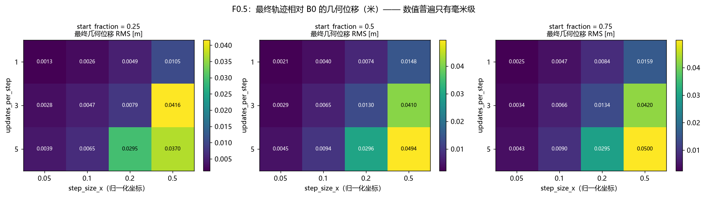
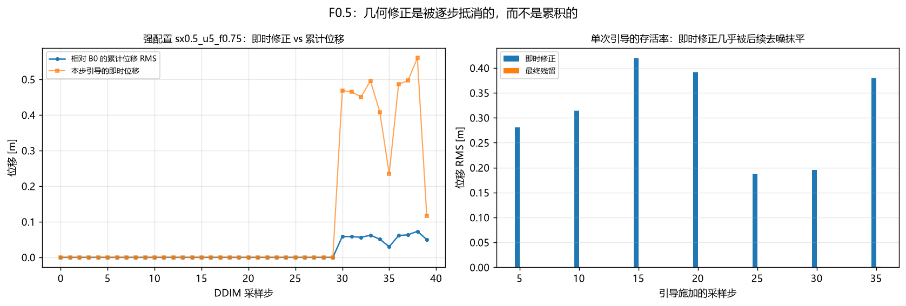
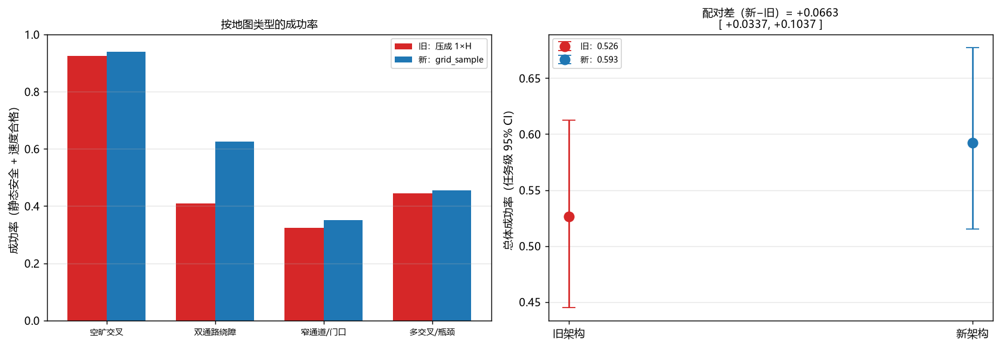
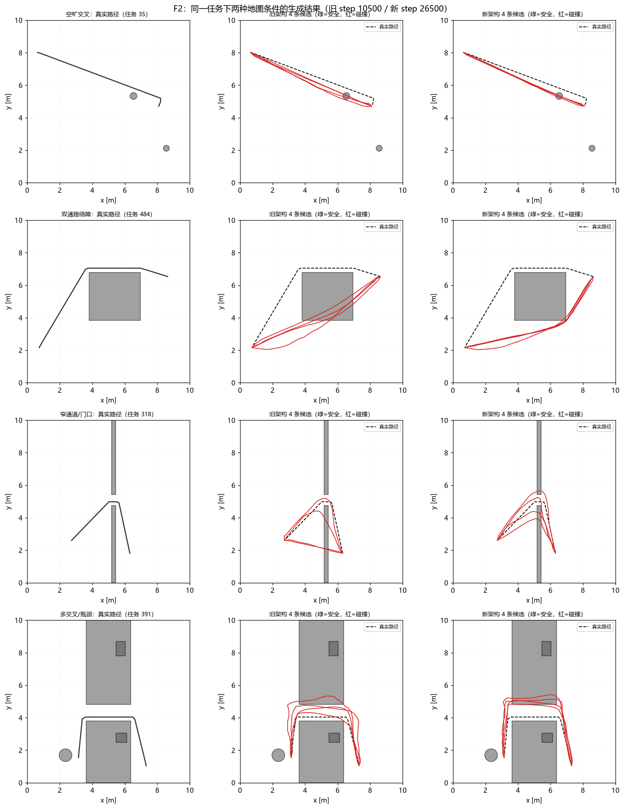

# No02 代码审计与修复报告（第 1 轮）

**日期**：2026-11-03
**分支**：`fix/audit-foundation`
**基线 tag**：`baseline_before_fix`（修复前 S0–S5 全部结果，不可覆盖）
**本轮范围**：F0（冻结）→ F0.5（几何引导诊断）→ F1（地图条件修复）→ F2（架构 A/B）
**明确未做**：S3–S5 全量重跑（按批复推迟，理由见 §6）

---

## 摘要

对《代码问题清单》的 12 项逐条核验：**11 项属实**（其中 6 项是实现层面的实质缺陷），**5 处子论断需要澄清**；另外发现 **3 个清单未列、但更严重的问题**。

本轮修复了其中最根本的一项——**地图条件被压成一维**。修复后：

- 机制层：64 个栅格的坐标映射单测全过；对「地图整体平移」的敏感度提升 **10 倍**（0.0399 vs 0.0041）；
- 端到端：30k 步训练、100 任务下成功率 **52.6% → 59.3%（+6.6 pp，95% CI [3.4, 10.4]，显著）**；
- 但**离 90% 的目标仍很远**，且增益集中在需要绕障的地图（双通路 +21.5 pp），窄门/瓶颈几乎不动。

同时用 F0.5 定位到一个此前未被发现、且比清单里任何一项都更致命的问题：

> **推理期的风险引导对几何几乎不起作用。** 36 组参数扫描中，最终轨迹相对无引导基线的位移最大只有 **5.0 cm**（路径长 8.81 m 的 0.57%）；单次引导 0.19–0.42 m 的修正在后续去噪中只剩 **0.01%–0.35%**。S5 里 7 个方法规划有效率完全相同（11/36，同一批任务）、A3 ≈ A2，根因就在这里——**当前实现真正生效的只有等待变量 `w`**。

因此结论是：**地图修复有效但不足以解锁 S3–S5 重跑**；必须先修引导注入方式，否则重跑只会再次得到「A3 不优于 B3」。

---

## 1. 清单核对结果

### 1.1 判定汇总

| 编号 | 问题 | 判定 | 本轮状态 |
|---|---|---|---|
| P0-1 | 地图特征被压成 1×H | **属实，比描述更严重** | ✅ **已修复** |
| P0-2 | 自动读取最新 checkpoint | **属实**（且产物里根本没有记录 ckpt） | ⬜ 未修（F2 已加 manifest，其余脚本待改） |
| P0-3 | 校准噪声种子依赖 λ | **属实** | ⬜ 未修 |
| P0-4 | Wilson 当作跨任务精度 | **属实**（措辞可再准） | ⬜ 未修（主图仍用 Wilson） |
| P1-1 | 等待点只查静态障碍 | **属实**（实测有 0.075 m 的危险等待点） | ⬜ 未修 |
| P1-2 | 等待优化器非 Adam | **部分属实**（S2 用 Adam，S4/S5 用投影 GD） | ◐ 已接入 `updates_per_step`，优化器未改 |
| P1-3 | B2 只有 k=3 | **属实** | ⬜ 未修 |
| P1-4 | 缺梯度范数曲线 | **部分属实**（S4 有，S2 没有） | ⬜ 未修 |
| P1-5 | gallery 是手工路径 | **属实** | ⬜ 未修 |
| P2-1 | 「通过 0 项」与数值冲突 | **属实**（`r7_max_abs_error=0.0067377`） | ⬜ 未修 |
| P2-2 | 耗时口径 / 入库策略 / 权重缺失 | **属实** | ⬜ 未修 |
| P2-3 | 缺 loss 曲线 PNG | **属实** | ⬜ 未修 |

### 1.2 需要澄清的 5 处

1. **P0-2「数据规模补充报告用了不同测试集」——是误会。**
   +1.9 pp 的两组都在同一个 `data/dataset` 测试集（489 条、200 任务×6）：
   run `032008`（medium 模型，59.4%）与 run `041902`（19k 模型，61.3%）。
   958 条测试集的那次（`041756`，0.5633）没有进表。但表里没写 run_id，容易被读反——表述需要加固，结论本身成立。

2. **P0-2「S3 与 S5 不同 checkpoint 不能拼端到端」——方向反了。**
   `RESULTS.md` 的 59.4% 与 S4/S5 是**同一个** checkpoint（`383287 / step 22500`）。
   真正打架的是 `docs/stages/S3/report.md` 被最后一次 16×16 评估覆盖成了 60.75%（ckpt `4b11c4`）。
   问题在「归档报告被覆盖」，不在「端到端混模型」。

3. **P1-2「等待优化器与原批复不一致」——只对 S4/S5 成立。**
   S2 的 `optim/path_wait.py` 正是 Adam + 双层投影（符合批复 §21）；只有 `guided_ddim.py` 是纯投影 GD。
   属于两个入口不一致，不是全项目违约。

4. **P2-2「误声称整个 results 被忽略」——文档滞后。**
   README 那句「不入 Git」是推送前写的，推送后没同步。性质是文档 bug。

5. **P0-4「制造虚假的统计精度」——措辞重了。**
   Wilson 在「固定这批任务、只估计执行随机性」这个推断对象下是正确的；错在**主图把推断对象换成了跨任务泛化**。
   我完全同意改任务级聚类 CI，但性质是口径错配。

### 1.3 清单漏掉的 3 个更严重问题

**（A）几何引导通道形同虚设**（见 §3）。这是本轮最大的发现，也是 S5 结论不可用的根因。

**（B）B0 不是纯基线。** B0 也开了 `λ_S·L_static + λ_K·L_kin + λ_G·L_geom` 的引导（只是没有机器人间项）。
论文表格若写「B0 = 独立 Diffusion」，审稿人会直接问「为什么无引导基线还要 15 步梯度修正」。

**（C）`guidance_updates_per_step` 是死配置。** 5 个 YAML 里都有，`src/` 里从未被读取。
这正好是缓解问题（A）的旋钮，本轮已接入。

---

## 2. F0：基线冻结

`docs/audit_fix/00_baseline_inventory.md` + `manifest_baseline.json`：

| 项 | 值 |
|---|---|
| 分支 / HEAD | `main` @ `5abfeb8` |
| Git tag | `baseline_before_fix` |
| 环境 | Python 3.12.13 / torch 2.11.0+cu128 / RTX 4070 / Windows 11 |
| 实验运行 | 37 次（S0–S5），逐个记录状态、文件数、体积 |
| 模型检查点 | 108 个 `.pt`，逐个记录路径、步数、best_val、SHA256 |
| 数据与配置 | 22 个文件（data/**、configs/*.yaml、pyproject、requirements、uv.lock）的 SHA256 |
| 修复前测试 | **69 passed / 0 failed**（本轮修复后为 **79 passed**） |

旧结果目录一律不覆盖，新实验使用新 run_id。

---

## 3. F0.5：几何引导有效性诊断（本轮最重要的发现）

### 3.1 设置

固定 checkpoint `383287/best.pt`、交叉场景（2 机器人）、40 步 DDIM、固定噪声种子。
扫描 `step_size_x ∈ {0.05, 0.1, 0.2, 0.5}` × `updates_per_step ∈ {1,3,5}` ×
`start_fraction ∈ {0.25, 0.5, 0.75}`，共 36 组。**每个采样步都保存 `x̂0`（米制）**，与无引导基线逐点比较。

`updates_per_step` 此前是死配置，本轮接入为内循环：每次更新后重新建图求梯度。

### 3.2 结果

- 无引导基线：硬风险 0.2046，路径长 8.81 m；
- **36 组里最终几何位移 RMS 最大只有 5.00 cm**（路径长度的 0.57%），多数在 0.4–1.5 cm；
- 位移随 `step_size_x`、`updates_per_step` 单调增长，但即使最强组合也只有 5 cm；
- 硬风险 0.2046 → 0.0102，但那是**等待变量**（中位 2.34 时隙）的贡献，不是几何。



### 3.3 是否被后续去噪抵消：是

只在第 k 步引导一次、之后不再引导：

| 引导步 k | 即时修正 | 最终残留 | 存活率 |
|---:|---:|---:|---:|
| 5 | 0.281 m | 0.0000 m | 0.01% |
| 10 | 0.315 m | 0.0000 m | 0.01% |
| 15 | 0.419 m | 0.0001 m | 0.01% |
| 20 | 0.391 m | 0.0001 m | 0.02% |
| 25 | 0.188 m | 0.0001 m | 0.03% |
| 30 | 0.196 m | 0.0001 m | 0.08% |
| 35 | 0.380 m | 0.0013 m | 0.35% |



两层机制：

1. 修正后的 `x̂0` 经 DDIM 一致性重算进入 `x_{t+1}` 时权重是 `sqrt(ᾱ_{t'})`，高噪声段（t≈750，`ᾱ≈0.05`）只有约 0.22；
2. 即使进入 `x_t`，下一步去噪会把扰动当噪声拉回先验流形——低噪声段（t≈125）0.38 m 的扰动已大于该步剩余噪声标准差（≈0.32 m）。

**结论**：当前「改一点 `x̂0`」的注入方式在 40 步 DDIM 里只能留下毫米级痕迹。这解释了 S5 中
7 个方法规划有效率完全相同（11/36，同一批任务）以及 A3 ≈ A2。

---

## 4. F1：地图条件修复

### 4.1 改了什么

`src/fhd/diffusion/model.py`：

- 旧实现（bug）：`F.interpolate(map_spatial, size=(1, H))` —— 把 8×8 特征的 **y 维压成 1**，
  结果只保留「地图某一行 × 路点索引」，与路点真实 x/y 完全无关；
- 新实现：`sample_map_features()` 用 `F.grid_sample` 按路点归一化坐标做双线性查询，
  `align_corners=True`、`padding_mode="border"`；
- 查询输入是**带噪轨迹 `x_t`**（训练/采样一致，不使用真实 `x0`，无信息泄漏）；
- 坐标约定写进 docstring：`grid[...,0]↔x↔列`、`grid[...,1]↔y↔行`，栅格第 0 行即 y 最小处，**不翻转**；
- 旧路径保留为 `map_conditioning="index"`，只用于 A/B。

### 4.2 测试（`tests/test_map_conditioning.py`，10 项）

| 测试 | 抓什么 |
|---|---|
| `test_grid_sample_corner_orientation` | 8×8 **全部 64 个格子**逐个打标，坐标必须精确命中（抓 x/y 互换） |
| `test_flip_would_be_detected` | 反证：故意翻转 y 轴时必须取错 |
| `test_no_vertical_flip` | 障碍在最后一行时 y=+1 命中、y=−1 不命中 |
| `test_out_of_range_uses_border` | 越界点贴边取值而非 0 |
| `test_different_waypoints_get_different_features` | 不同路点特征不同 |
| `test_same_obstacle_ratio_different_position` | 障碍占比相同、位置不同 → 特征不同 |
| `test_model_uses_grid_sample_and_gradients_flow` | 对轨迹的梯度有限 |
| `test_local_feature_differs_between_mirrored_maps` | 上下镜像地图给出不同预测 |
| `test_old_index_conditioning_is_inert` | 旧实现原理上对坐标不敏感 |
| `test_real_map_encoder_keeps_2d_shape` | 真实 64×64 栅格编码后仍是二维 |

### 4.3 行为证据：地图敏感度探针

固定轨迹与时间步，只替换输入地图，测 ε 预测的 RMS 变化（基线 ε RMS≈1.8–1.9）：

| 模型 | 步数 | 平移地图 | 全空地图 | 换另一张图 |
|---|---:|---:|---:|---:|
| 旧（index） | 6,500 | 0.0078 | 0.1046 | 0.0379 |
| 新（grid_sample） | 6,500 | 0.0035 | 0.0160 | 0.0108 |
| 旧（index） | 10,500 | 0.0041 | 0.0611 | 0.1448 |
| 新（grid_sample） | 26,500 | **0.0399** | 0.0421 | **0.2758** |
| 旧（index，主模型 40k 训练） | 22,500 | 0.0115 | 0.2178 | 0.1673 |
| 新（grid_sample，19k 数据 50k 训练） | 37,500 | 0.0817 | 0.2133 | 0.1538 |

两个要点：

1. **6,500 步时两个架构都几乎不看地图**——这解释了为什么 8k 步的 A/B 看不出差异；
2. 训练到 10k–26k 步后，新架构对「空间平移」的敏感度比旧实现高 **一个数量级**（0.0399 vs 0.0041），
   证明逐点二维查询确实把「路点在哪里、障碍在哪里」接进了网络。

---

## 5. F2：架构 A/B 对照

### 5.1 设置

同一训练数据（`data/dataset` medium，4,819 条 / 50 张地图）、同种子、同 batch 96、
同 `map_spatial_res=16`，**唯一差异是 `map_conditioning`**。评估用固定任务集，
两模型共用同一任务与同一噪声种子，成功率 = 静态连续几何安全 **且** 每段 ≤0.6 m。

### 5.2 结果：8k → 30k、20 → 100 任务

| 训练步数（旧/新 best） | 任务数 | 旧 | 新 | 配对差 [95% CI] | 显著 |
|---|---:|---:|---:|---|---|
| 6,500 / 6,500 | 20 | 0.5375 | 0.5062 | −0.031 [−0.063, 0.000] | 否 |
| 10,500 / 26,500 | 20 | 0.5750 | 0.6313 | +0.056 [−0.050, +0.156] | 否 |
| **10,500 / 26,500** | **100** | **0.5263** | **0.5925** | **+0.066 [+0.034, +0.104]** | **是** |

注意 20 个任务时符号为负、扩到 100 个任务后符号反转且显著——**这正是 P0-4 警告的统计陷阱**，
也说明 20 任务不足以做任何架构判断。



按地图类型（100 任务）：

| 类型 | 旧 | 新 | 差值 |
|---|---:|---:|---:|
| 空旷交叉 | 0.925 | 0.940 | +0.015 |
| 双通路绕障 | 0.410 | 0.625 | **+0.215** |
| 窄通道/门口 | 0.325 | 0.350 | +0.025 |
| 多交叉/瓶颈 | 0.445 | 0.455 | +0.010 |

增益集中在**需要绕障**的地图；窄门/瓶颈几乎不动，说明那类失败是**表示精度**问题
（H=32 折线要穿过 0.55–0.8 m 的缺口），不是地图信息问题。



---

## 6. 五个结论问题

| # | 问题 | 回答 |
|---|---|---|
| 1 | 地图特征编码问题是否修复 | **是**。64 格坐标映射单测全过；空间平移敏感度 ×10；端到端 +6.6 pp 显著 |
| 2 | 新架构是否显著提高单机成功率 | **是，但幅度有限**：52.6% → 59.3%（100 任务，+6.6 pp [3.4, 10.4]），远未到 90% |
| 3 | 风险引导是否真正改变几何轨迹 | **几乎没有**：36 组最大最终位移 5.0 cm（0.57%）；收益全来自等待 |
| 4 | 几何修正是否被后续 DDIM 抵消 | **是，几乎完全**：即时 0.19–0.42 m → 残留 0.0001 m，存活率 0.01%–0.35% |
| 5 | 是否值得进入完整 S3–S5 重跑 | **暂不值得**。两个阻塞：几何引导通道坏了；基座 59.3% 撑不起 `0.59^N` 的规划有效率 |

### 为什么不能直接重跑 S5

- 若现在重跑，A3 仍只能通过 `w` 起作用，必然再次得到 A3 ≈ A2 且劣于 B3，
  无法推进对「首碰吸收是否有效」的判断；
- 基座 59.3% 时，N=2 的规划有效率上限约 35%，N=6 约 5%，方法间差异会被静态失败淹没。

---

## 7. 遗留问题与下一步（按优先级）

### 7.1 下一步（解锁 S5 的唯一前提）

**修引导注入方式**，三选一做 A/B：

- (a) 直接把梯度加到 `x_t`：`x_t ← x_t − η·g_x`，η 按 `sqrt(1−ᾱ_t)` 缩放；
- (b) 重建而非微调：`x_t ← sqrt(ᾱ_t)·x̂0_guided + sqrt(1−ᾱ_t)·ε_θ`，让修正「重新加噪」后固化；
- (c) 两者组合。

**验收标准**：沿用 F0.5 的保留率指标，**单次修正的最终存活率 > 50%**，再谈 S5。

### 7.2 提高基座（与 7.1 并行）

- H=64 或自适应路点（窄门/瓶颈是精度问题）；
- 采样期对静态约束做硬投影，而不是只靠软惩罚；
- 数据规模已验证不是瓶颈（4.8k → 19.2k 只 +1.9 pp）。

### 7.3 清单中尚未修复的项

| 编号 | 待办 | 备注 |
|---|---|---|
| P0-2 | 所有脚本强制 `--ckpt`，写 `experiment_manifest.json`（路径+SHA256+步数+结构+Git HEAD） | F2 已实现，其余脚本待改 |
| P0-3 | 校准固定噪声、每任务多噪声求平均、配置用副本 | |
| P0-4 | 主图改任务级聚类 CI，逐 p 给 A3−B3 配对差 | 聚类 CI 已计算并存盘，只是没进主图 |
| P1-1 | 等待点动态占用检查；`strict` 无候选时显式 `unsafe_fallback=True`；复核 S2 的 `follow` 危险等待 | S2 实测有 0.075 m 的危险等待点 |
| P1-2 | `projected_gd` 与 `projected_adam` 两种选项 + 硬门槛复核 | `updates_per_step` 已接入 |
| P1-3 | B2 补 k=3/5/7，验证集选参 | |
| P1-4 | S2 记录 `‖∇_Q‖`、`‖∇_w‖` 曲线 | S4 已有 |
| P1-5 | gallery 加 `source=handcrafted/A*/diffusion-B0/B0` 标签，补 4 类地图的真实 Diffusion 成功/失败样例 | |
| P2-1 | 修正 `RESULTS.md` 的 `<0.005` → `0.0067377`；S1 报告「通过 0 项」；`stage_status.tests` 不再为空 | |
| P2-2 | 拆分 `planning/simulation/report/total` 耗时；同步 README 的入库策略；记录本地 checkpoint 的 SHA256 与恢复位置 | |
| P2-3 | 从 `train_log.csv` 生成 train/val loss 与梯度范数 PNG | |

---

## 8. 复现命令

```powershell
# F0 冻结
powershell -c ".\.venv\Scripts\python.exe scripts/audit_f0_freeze.py"

# F0.5 引导诊断（约 3 分钟）
powershell -c ".\.venv\Scripts\python.exe scripts/audit_f05_guidance_diagnosis.py --ckpt <best.pt>"

# F1 单测
powershell -c ".\.venv\Scripts\python.exe -m pytest tests/test_map_conditioning.py -q"

# F2 架构 A/B（先各训 8000 / 30000 步）
powershell -c ".\.venv\Scripts\python.exe scripts/train_diffusion.py --config configs/audit_arch_index.yaml --steps 8000 --data data/dataset"
powershell -c ".\.venv\Scripts\python.exe scripts/train_diffusion.py --config configs/audit_arch_grid.yaml  --steps 8000 --data data/dataset"
powershell -c ".\.venv\Scripts\python.exe scripts/audit_f2_compare.py --old <old_best.pt> --new <new_best.pt> --per-kind 25"
```

---

## 9. 文件索引

```
docs/audit_fix/
  00_baseline_inventory.md        修复前冻结清单（37 runs / 108 ckpt 的 SHA256）
  01_guidance_diagnosis.md        F0.5 自动报告（36 组扫描 + 存活率）
  02_map_conditioning_fix.md      F1/F2 自动报告（100 任务 A/B）
  03_architecture_ab_scaleup.md   8k→30k、20→100 任务的推进与解释
  04_final_research_assessment.md 五个问题的详细证据
  05_round1_report.md             本文件
  figures/                        6 张（扫描热图、存活率、按类型成功率、配对散点、样例、路径对比）
  tables/                         8 个 CSV（含 f05_per_step 逐采样步 1440 行）
results/
  F05_guidance_diagnosis/<run>/   36 组 × 40 步的逐采样步轨迹与曲线
  F2_architecture_ab/<run>/       4 个 A/B run（含 experiment_manifest.json）
  S3_diffusion_training/<run>/    4 个新训练 run（8k/30k × 旧/新）
```

所有 run 目录含 `config_snapshot.yaml`、`metrics.csv`、`tables/`、`plots/`、`report.md`、
`stage_status.json`；F2 另有 `experiment_manifest.json`（checkpoint 路径与 SHA256、任务列表、
评估参数、配对结果）。

---

## 10. 一句话结论

**地图条件这个 bug 是真的、修好了、也有 6.6 pp 的显著收益；但它不是当前最大的瓶颈。
真正卡住整条研究链的是「引导改了 `x̂0`、随后被 DDIM 去噪抹平」——在这个修好之前，
A3 与 A2 没有区别，S3–S5 重跑只会复现同一个负结果。**
