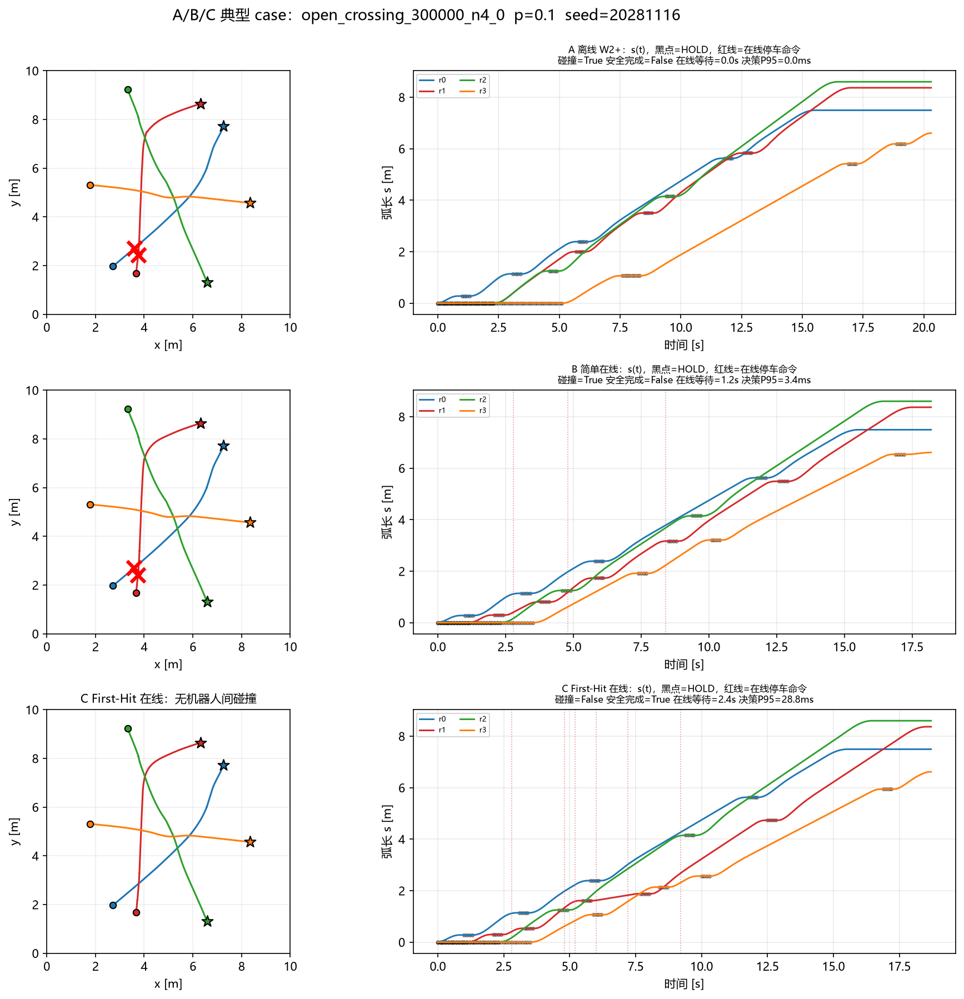
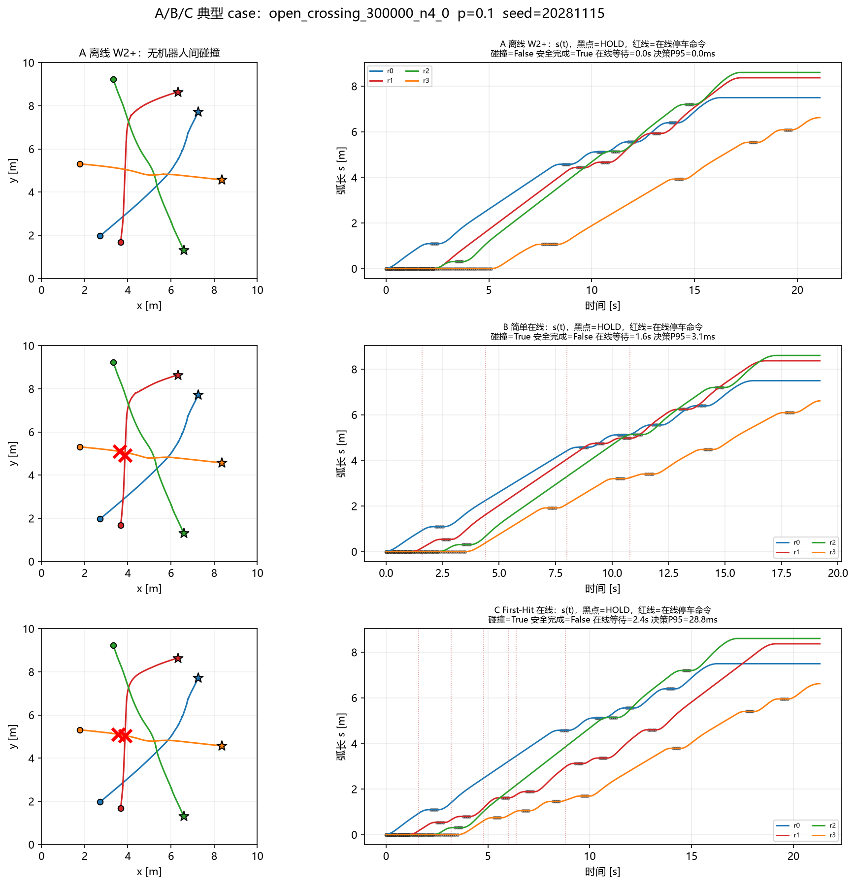
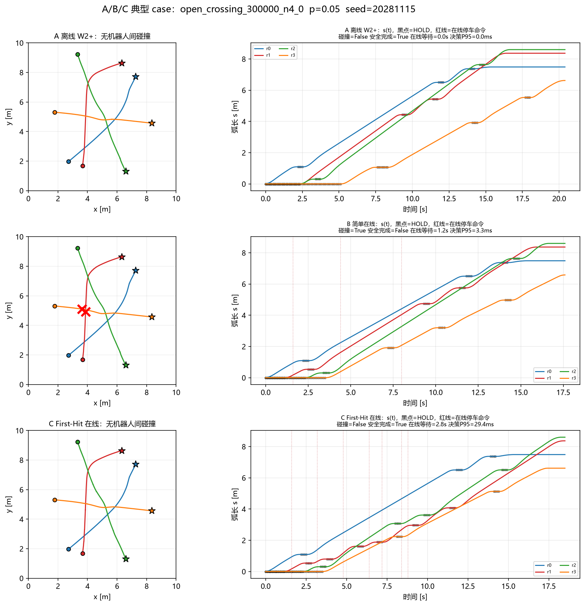

# 03 A/B/C 配对对照与失败分析

**日期**：2026-11-05  
**分支**：`experiment/online-temporal-coordination`  
**实验目录**：`results/Online_Temporal/03_ab_comparison/`  
**设置**：N=4，8 个冻结任务（`open_crossing_300000/300003/300006/300009` 各 2 个），
p∈{0,0.05,0.1,0.2}，每任务/概率 30 个独立事件种子；A/B/C 共 **2,880 条配对运行**，
总耗时 **41.3 min**。同一路径、MPC 参数、`d_safe=0.35`、预生成外部暂停事件表、
`dt_slot=0.4 s` 决策周期。

**方法**：

- **A**：离线 W2+，执行期不看实时状态；
- **B**：原始等待 + 简单在线冲突预测/固定优先级让行；
- **C**：原始等待 + 当前状态条件化 First-Hit 有限搜索（每次最多 2 个候选/机器人，1 个时隙等待）。

---

## 1. 主结果

| 方法 | p | 机器人间碰撞 | 安全完成 | 平均完成时间 (s) | 总等待 (s) | 在线等待 (s) | 在线决策均值/P95 (ms) |
|---|---:|---:|---:|---:|---:|---:|---:|
| A W2+ | 0 | 0.125 | 0.875 | 19.11 | 11.90 | 0 | — |
| A W2+ | 0.05 | 0.208 | 0.792 | 20.28 | 14.31 | 0 | — |
| A W2+ | 0.1 | 0.321 | 0.679 | 21.50 | 16.57 | 0 | — |
| A W2+ | 0.2 | 0.508 | 0.492 | 23.93 | 20.95 | 0 | — |
| B 简单在线 | 0 | **0.500** | **0.500** | 17.16 | 8.05 | 0.85 | 3.2 / 4.1 |
| B 简单在线 | 0.05 | **0.587** | 0.412 | 18.50 | 10.62 | 1.21 | 3.3 / 4.2 |
| B 简单在线 | 0.1 | **0.642** | 0.358 | 19.55 | 12.73 | 1.32 | 3.3 / 4.1 |
| B 简单在线 | 0.2 | **0.796** | 0.204 | 21.92 | 16.86 | 1.41 | 3.2 / 4.1 |
| C First-Hit 在线 | 0 | 0.125 | 0.875 | 16.51 | 7.20 | 0.00 | 4.1 / 8.1 |
| C First-Hit 在线 | 0.05 | **0.071** | **0.929** | 18.90 | 11.01 | 1.45 | 8.3 / 29.3 |
| C First-Hit 在线 | 0.1 | **0.088** | **0.913** | 20.45 | 13.72 | 1.89 | 9.1 / 29.9 |
| C First-Hit 在线 | 0.2 | **0.188** | **0.812** | 23.42 | 18.49 | 2.37 | 8.5 / 26.5 |

**健康度**：三组均 `timeout=0`、`mpc_failures=0`、`infeasible_stops=0`；
在线命令 3424/3424（C）、2872/2872（B）全部被执行器接受；
C 的决策超 0.4 s 次数为 **0**，最大 P95 约 30 ms。

**配对差（任务级 bootstrap，负=碰撞更少）**：

| 对照 | p=0 | p=0.05 | p=0.1 | p=0.2 |
|---|---:|---:|---:|---:|
| B − A | +0.375 [0.125, 0.750] | +0.379 [0.150, 0.554] | +0.321 [0.121, 0.508] | +0.287 [0.200, 0.375] |
| C − B | −0.375 [−0.875, +0.125] | −0.517 [−0.587, −0.446] | −0.554 [−0.650, −0.458] | −0.608 [−0.696, −0.508] |
| C − A | 0.000 [−0.375, +0.375] | −0.138 [−0.338, +0.025] | **−0.233 [−0.396, −0.083]** | **−0.321 [−0.446, −0.163]** |

安全完成差的符号相反（C−A 为正）；C−A 的平均完成时间差为
−2.60 / −1.38 / −1.05 / −0.51 s（负=更快）。

---

## 2. 三个研究问题的回答

### Q1：在线本身有没有价值？B vs A

**在这组冻结任务上没有。** B 的碰撞率在所有 p 上都高于 A（+0.29 到 +0.38），
安全完成率低 20–29 个百分点。B 的在线等待只有 0.85–1.41 s，说明它并没有“靠多等”
换安全；相反，它把机器人停在了不该停的地方/时刻。

作为诊断，A 的原始等待（非 W2+）在阶段一重跑中 N4 前 8 任务的碰撞率约为
0.125/0.621/0.738/0.829（p=0/0.05/0.1/0.2，**不同事件种子表**）。B 在 p≥0.05
时略优于这个原始参考，但在 p=0 从 0.125 恶化到 0.500——**简单在线在无暂停时也会
制造不必要的停车与新的冲突**。因此“只做时间调整”在 B 的规则下不成立。

### Q2：First-Hit 有没有额外价值？C vs B

**有，且很大。** 在同一停车点集合、动作约束、决策周期和执行器下，C 比 B 的碰撞率低
0.38–0.61，安全完成率高 0.38–0.61；代价是每任务多 0.4–1.6 s 在线等待，
完成时间多 0.4–1.5 s。

### Q3：C 是否优于离线 W2+？C vs A

- p=0：两者相同（0.125）；C 从原始计划出发，无法修复该原始计划在 p=0 的
  `open_crossing_300000_n4_0` 碰撞（最小间距 0.3409 m < 0.35）。
- p=0.05：C 低 13.8 pp，但 95% 区间跨 0，只能算趋势。
- p=0.1：C 低 **23.3 pp**，区间 [−0.396, −0.083]，显著。
- p=0.2：C 低 **32.1 pp**，区间 [−0.446, −0.163]，显著。
- C 的总等待和 makespan 反而低于 A（因为它从原始计划出发，而 A 的 W2+ 加了大量
  离线等待）；这不是“靠无限等待”换安全。

**结论（本轮）**：在线时序调整本身在 B 的规则下**没有**价值；但**条件化 First-Hit
在线等待 C 明显优于 B，并在 p=0.1/0.2 显著优于离线 W2+**。这是本轮最重要的正结果，
但仍需在更多任务/种子上确认，且不能宣称安全保证。

---

## 3. 四类典型案例

### 3.1 成功避免碰撞



`open_crossing_300000_n4_0`, p=0.1, seed=20281116：A/B 均碰撞，C 通过 2.4 s 在线等待
（s(t) 中的红色虚线）让机器人 1 在交叉前停下，最终无碰撞且安全完成。

### 3.2 发现过晚/停错机器人



同任务同 p，seed=20281115：A（W2+）安全，B 与 C 都碰撞。C 已经发出 2.4 s 在线等待，
但仍然在错误的位置/时刻让行，说明“风险下降”不等于“真实碰撞被消除”；条件化 DP 的
剩余路径离散化与制动时序仍有误差。

### 3.3 预测误判造成不必要等待



p=0.05, seed=20281115：A 安全，C 也安全，但 C 付出了 2.8 s 额外在线等待；B 碰撞。
这是 First-Hit 风险高估/动作选择保守的典型代价：安全无损失，但效率有损失。

### 3.4 死锁/超时

本组 2,880 条运行中 **没有 timeout、没有 MPC 失败、没有不可行停车**；B/C 的等待上限
（6 次/机器人）与自动恢复使“全体永久等待”没有发生。不能据此证明任意场景无死锁，
只说明本组冻结任务未触发。

---

## 4. 消融/敏感性（本轮范围内）

- **B 的在线动作**：p=0 时 B 仍发出 0.85 s 等待并导致 0.500 碰撞（原始参考 0.125），
  说明简单冲突预测的“停车点/让行机器人”选择是主要失败源，而不是执行器。
- **C 的风险项**：把 C 的在线动作关闭后退化为原始计划（p=0 碰撞 0.125；p=0.1 的原始
  参考约 0.738），因此 C 的增益来自在线动作本身。
- **计算开销**：C 的 P95 约 30 ms，远低于 400 ms 决策周期；相对一次 MPC 仿真
  （~0.8–1.5 s）仍便宜一个量级，但比 B 贵 2–3 倍。

---

## 5. 局限与不能宣称的内容

1. 只有 8 个 N4 任务、30 seeds；任务/地图聚类区间仍宽，尤其 p=0.05 的 C−A 跨 0。
2. A 用 W2+，B/C 用原始等待；这是“在线 vs 离线优化”的设定，不是“同起点加在线”。
   公平性体现在 B/C 共享同一执行接口/事件/候选点；A 的起点不同需在结论中明示。
3. C 的 First-Hit 是**条件化近似**，不是校准的 MPC 真实概率；风险下降不等于碰撞消除，
   3.2 的失败案例就是证据。
4. 静态障碍未纳入本轮 A/B/C（所选地图障碍不在路径上）；不能把“机器人间无碰撞”
   当作“静态安全”。
5. 约束违反沿用旧 L1 多边形口径（B/C 分别 106/104 次）；欧氏速度界是否越界没有在
   本组逐 run 记录，需在后续统一口径重跑；不能把 L1 计数直接解释为物理超速。
6. 未做 N=2 诊断、N=6、在线滚动窗口/恢复策略、通信延迟；未进入 P3/P4 的正式研究。

---

## 6. 复现

```powershell
# 阶段一修复后基准（4 N2 + 8 N4，30 MC）
.\.venv\Scripts\python.exe scripts\mpc_execution_benchmark.py `
    --n2-tasks 4 --n4-tasks 8 --n-mc 30 --ps "0,0.05,0.1,0.2" `
    --out results\Online_Temporal\01_execution_fix

# A/B/C 配对
.\.venv\Scripts\python.exe scripts\online_temporal_benchmark.py `
    --out results\Online_Temporal\03_ab_comparison `
    --n4-tasks 8 --n-mc 30 --ps "0,0.05,0.1,0.2"

# 典型 case
.\.venv\Scripts\python.exe scripts\online_temporal_visualize.py `
    --task-id open_crossing_300000_n4_0 --p 0.1 --seed 20281116
```
