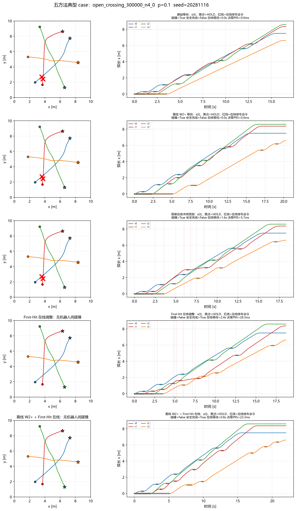
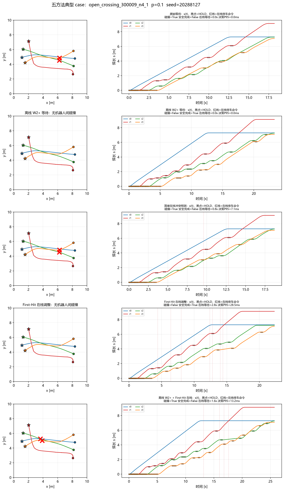

# 03 离线 W2+ 与实时 First-Hit 风险修正协同

**日期**：2026-11-05  
**方法**：`offline_plus_firsthit` = 离线 W2+ 等待计划 + 执行期当前状态条件化 First-Hit 在线修正  
**结果**：`results/Online_Temporal_v2/01_pilot/`（8 N4 任务、30 seeds、4 个 p）  
**实现**：`OnlineFirstHitCoordinator(paths, wait_slots=w2, ...)`；在线动作只增加等待，
不删除/覆盖离线等待。

---

## 1. 主结果

| 方法 | p | 碰撞 | 安全完成 | 完成时间 (s) | 总等待 (s) | 在线等待 (s) | 决策均值/P95 |
|---|---:|---:|---:|---:|---:|---:|---:|
| offline_w2plus | 0 | 0.125 | 0.875 | 19.11 | 11.90 | 0 | — |
| offline_plus_firsthit | 0 | **0.000** | **1.000** | 19.20 | 11.95 | 0.05 | 3.9 / 6.8 ms |
| offline_w2plus | 0.05 | 0.208 | 0.792 | 20.28 | 14.31 | 0 | — |
| offline_plus_firsthit | 0.05 | **0.033** | **0.967** | 20.71 | 14.59 | 0.31 | 4.2 / 8.6 ms |
| offline_w2plus | 0.1 | 0.321 | 0.679 | 21.50 | 16.57 | 0 | — |
| offline_plus_firsthit | 0.1 | **0.046** | **0.954** | 22.27 | 17.12 | 0.61 | 4.9 / 12.7 ms |
| offline_w2plus | 0.2 | 0.508 | 0.492 | 23.93 | 20.95 | 0 | — |
| offline_plus_firsthit | 0.2 | **0.104** | **0.896** | 25.21 | 22.04 | 1.12 | 5.6 / 17.3 ms |

**配对差（hybrid − offline）**：

| p | 碰撞差 | 95% 区间 | 安全完成差 | 完成时间差 | 总等待差 |
|---:|---:|---|---:|---:|---:|
| 0 | −0.125 | [−0.375, 0.000] | +0.125 | +0.09 s | +0.05 s |
| 0.05 | **−0.175** | [−0.333, −0.050] | +0.175 | +0.43 s | +0.29 s |
| 0.1 | **−0.275** | [−0.400, −0.163] | +0.275 | +0.77 s | +0.56 s |
| 0.2 | **−0.404** | [−0.492, −0.321] | +0.404 | +1.29 s | +1.09 s |

- p=0.05/0.1/0.2 的碰撞下降均显著；p=0 的区间刚好触及 0（0 vs 1 个任务碰撞）。
- 代价很小：在线等待仅 0.05–1.12 s，完成时间增加 0.09–1.29 s；
  相比离线 W2+ 已经付出的 11.9–20.9 s 计划等待，这个增量可以接受。
- 全部运行 **0 timeout、0 MPC 失败、0 不可行停车、0 决策超预算**；
  在线请求 1,254/1,254 被接受。

---

## 2. 与单独方法比较

| 对照 | p=0.05 | p=0.1 | p=0.2 |
|---|---:|---:|---:|
| hybrid − firsthit_online（碰撞） | −0.038 [−0.083,+0.012] | −0.042 [−0.092,+0.004] | **−0.083 [−0.171,−0.021]** |
| hybrid − offline_w2plus（碰撞） | **−0.175** | **−0.275** | **−0.404** |
| hybrid − firsthit_online（完成时间） | +1.81 s | +1.82 s | +1.80 s |
| hybrid − firsthit_online（总等待） | +3.58 s | +3.40 s | +3.55 s |

**解释**：混合方法不是简单“多加等待”。离线 W2+ 先把计划等待放到较优位置，
在线 First-Hit 只修正随机暂停造成的剩余偏差；因此它的在线等待比单独 First-Hit 少
1.1–1.25 s，但总等待更多（离线计划本身更多）。在 p=0.2，混合显著优于单独 First-Hit；
p=0.05/0.1 的额外增益接近但未完全显著。

---

## 3. 配对成功/失败

按 `(task_id, p, seed)` 配对：

- 离线碰撞、混合安全：**240**
- 离线安全、混合碰撞：**5**
- 两者都碰撞：**39**
- 两者都安全：**676**

混合方法把大量离线失败转成安全，但**仍有 5 次把离线安全变成碰撞**，不能宣称“组合一定安全”。

### 典型案例

**成功**：`open_crossing_300000_n4_0`, p=0.1, seed=20281116。原始/离线/简单均碰撞；
First-Hit 在线与混合安全，混合只多 0.8 s 在线等待。

**失败**：`open_crossing_300009_n4_1`, p=0.1, seed=20288127。离线 W2+ 安全，
混合方法因在线追加等待而碰撞；这是“在线修正破坏离线计划”的直接证据。

失败原因（从 s(t)/动作可见）：

- 离线计划本身有一个较紧的时序窗口；在线追加 1.6 s 等待改变了到达顺序；
- First-Hit 的短时剩余路径近似没有完整建模“等待结束后恢复”的相位，风险下降
  不等于真实碰撞消除；
- 这说明组合需要“只在离线计划明显被随机暂停破坏时介入”的门控，而不是每个
  预测冲突都修改。

---

## 4. 结论

**在本轮 8 个 N4 任务、30 seeds 上，离线 W2+ + 实时 First-Hit 修正是目前最好的方法**：
碰撞从 0.321 降到 0.046（p=0.1）、从 0.508 降到 0.104（p=0.2），
安全完成显著提高，代价是 0.6–1.1 s 在线等待和 0.8–1.3 s 完成时间。
它不是安全保证；5 个失败配对说明需要门控与更准确的恢复模型。

阶段三判定：**有可辨识增益，值得进入更大规模评测**；但不应再增加复杂融合模块。
